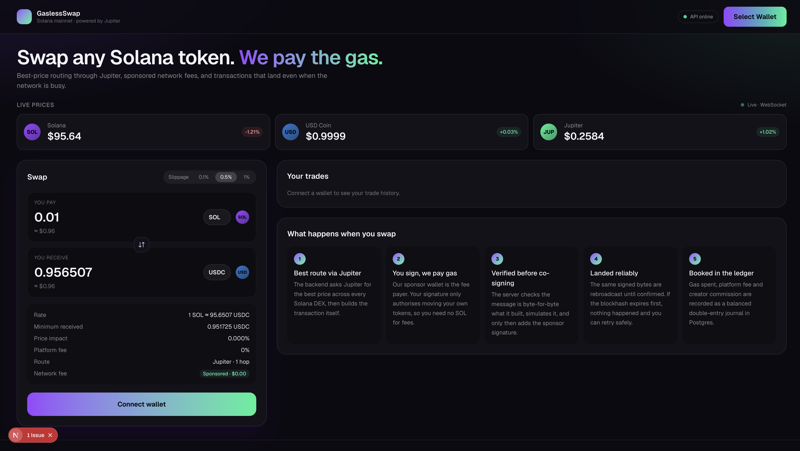

# Solana Trade Backend

A production-style backend for a Solana trading app. Users swap tokens without holding SOL for gas, while the platform takes a fee and pays a commission to the creator who referred the trade.

| Area | Where |
| --- | --- |
| Swap routing through Jupiter | `src/solana/jupiter.ts` |
| Sponsored gas (platform pays network fees) | `src/solana/txBuilder.ts`, `src/solana/sponsorPolicy.ts`, `src/solana/verify.ts`, `src/trade/sponsorGuard.ts` |
| Landing and confirming transactions (retries, blockhash expiry) | `src/solana/sender.ts` |
| Fee ledger (double entry) | `src/ledger/` |
| Creator commission | `src/commission/commission.ts` |
| Live price pipeline (Jupiter, Redis pub/sub, WebSocket) | `src/prices/pricePipeline.ts` |
| HTTP API | `src/api/server.ts` |
| AWS infrastructure (Elastic Beanstalk Node.js, ElastiCache, Secrets Manager, alarms) | `infra/terraform/` |
| CI/CD | `.github/workflows/ci.yml` |
| Runbook | `docs/RUNBOOK.md` |
| Architecture and design decisions | `docs/ARCHITECTURE.md` |

Stack: TypeScript (Node 22), Fastify, Postgres (Supabase), Redis, `@solana/web3.js`, Vitest, Terraform. Frontend: Next.js + Solana wallet adapter in `web/`.



**Deploying:** see [docs/DEPLOY.md](docs/DEPLOY.md). The frontend goes on Vercel, the backend and Redis on Render, and the database on Supabase, all on free tiers.

## How a trade works

```
Client                         API                                   Solana / Jupiter
  | POST /v1/trades/quote        |                                          |
  |----------------------------->| quote + swap-instructions ------------->| Jupiter
  |                              | build v0 tx, fee payer = sponsor         |
  |                              | save trade + hash of the exact message   |
  |<---- unsigned tx (base64) ---|                                          |
  | user signs in wallet         |                                          |
  | POST /v1/trades/:id/submit   |                                          |
  |----------------------------->| verify hash + user signature             |
  |                              | simulate (failed txs still cost gas)     |
  |                              | sponsor co-signs, save signature         |
  |<---- 202 { signature } ------| send + rebroadcast until confirmed ----->| RPC(s)
  |                              |   or block height > lastValidBlockHeight |
  |                              | settle: status + ledger journals (1 DB tx)
  | GET /v1/trades/:id           |                                          |
```

## Running locally

You need Node 22, a free [Supabase](https://supabase.com) project (the Postgres database), and Redis (`brew install redis && brew services start redis`).

```bash
cp .env.example .env
# DATABASE_URL: Supabase dashboard -> Connect -> "Session pooler" connection string
npm install
npm run gen:sponsor-key            # paste SPONSOR_SECRET_KEY into .env, fund the printed address with a little SOL
# set PLATFORM_FEE_OWNER to a wallet you control, and create its USDC token account to collect fees
npm run migrate                    # creates the tables in Supabase
npm run dev
```

Frontend, in a second terminal:

```bash
cd web && cp .env.example .env.local && npm install && npm run dev   # http://localhost:3000
```

Then:

```bash
curl localhost:8080/readyz
curl localhost:8080/v1/prices
# full swap from the client side (uses REAL funds on mainnet, use a throwaway wallet):
USER_SECRET_KEY=... npx tsx scripts/demo-swap.ts 10000000
```

## Tests

```bash
npm test        # unit tests, no network needed
npm run typecheck
```

What the tests cover:

- **sender**: lands, fails on-chain, expires after `lastValidBlockHeight`, rebroadcasts the same bytes, survives flaky RPCs and rate limits, fans out to extra RPCs.
- **sponsor security**: rejects instructions that reference the sponsor (for example a transfer that drains it), rejects programs that aren't on the allow list, rejects tampered messages and missing or forged signatures, and checks the priority-fee cap math.
- **ledger and commission**: journals balance per mint, failed swaps book gas only, rounding never overpays creators, and amounts work beyond the JavaScript number range.
- **Jupiter client**: retries 429 and 5xx responses, doesn't retry 4xx, and decodes instructions.
- **prices**: parsing, rejecting bad prices, and the "only publish real moves" filter.

## API

| Method | Path | Notes |
| --- | --- | --- |
| GET | `/v1/quotes/preview` | read-only price check (no tx built, no sponsor budget used) |
| GET | `/v1/trades?wallet=` | last 20 trades for a wallet |
| POST | `/v1/trades/quote` | `{ wallet, inputMint, outputMint, amount, slippageBps?, creatorId? }`, where `amount` is an integer string in base units |
| POST | `/v1/trades/:id/submit` | `{ signedTransaction }` returns `202 { signature }` |
| GET | `/v1/trades/:id` | status is one of `built`, `submitted`, `confirmed`, `failed`, `expired` |
| GET | `/v1/prices` | latest snapshot from Redis |
| WS | `/v1/prices/stream` | pushes price ticks |
| GET | `/v1/creators/:id/earnings` | commission owed per mint |
| POST | `/v1/admin/creators` | header `x-admin-key` |
| GET | `/v1/admin/ledger` | header `x-admin-key` |
| GET | `/healthz`, `/readyz`, `/metrics` | liveness, readiness, Prometheus metrics |
